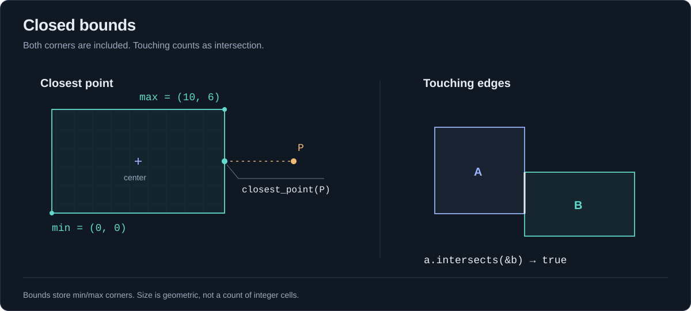

# Bounds: closed rectangles and AABBs

[Home](../README.md) · [Index](README.md) · [Vectors](vectors.md) · [Numeric policies](numerics.md)

[Construction](#construction) · [Queries](#queries) · [Expansion](#expansion) · [Validity and equality](#validity)

`Bounds2<T>` stores public `Vector2<T>` fields `min, max`. `Bounds3<T>` uses `Vector3<T>` with the same methods. Regions are axis-aligned and closed: every minimum and maximum edge is included. These represent geometric regions, not grid storage.



<a id="construction"></a>
## Constructors

Methods require `T: PartialOrd + ToF64`.

| Method | Result | Validation |
|---|---|---|
| `new(min, max)` | `Option<BoundsN<T>>` | Requires min <= max on every axis and finite coordinates |
| `from_start_end(start, end)` | `Option<BoundsN<T>>` | Sorts each axis independently; rejects non-finite coordinates |
| `from_center_size(center, size)` | `Option<BoundsN<f64>>` | Full size, not extents; rejects negative/non-finite sizes, invalid centers or overflowing corners |
| `default()` | `BoundsN<T>` where T: Default | Both corners default; numeric types produce an origin point |

Zero sizes are allowed. Negative coordinates are allowed; a negative **size** or reversed min/max is a separate issue. Sorting preserves integer corner values without round-tripping through f64.

```rust
use yagmath::bounds::{Bounds2, Bounds3};
use yagmath::vector::{Vector2, Vector3};
let rect = Bounds2::new(Vector2::new(-5, -2), Vector2::new(5, 8)).unwrap();
assert!(rect.contains(Vector2::new(-5, -2)));
let sorted = Bounds2::from_start_end(Vector2::new(10, 0), Vector2::new(0, 20)).unwrap();
assert_eq!(sorted.min, Vector2::new(0, 0));
assert_eq!(sorted.max, Vector2::new(10, 20));
let centered = Bounds2::from_center_size(Vector2::new(5, 10), Vector2::new(3, 6)).unwrap();
assert_eq!(centered.min, Vector2::new(3.5, 7.0));
assert_eq!(centered.max, Vector2::new(6.5, 13.0));
let box3 = Bounds3::new(Vector3::new(0, 0, 0), Vector3::new(1, 2, 3)).unwrap();
assert!(box3.contains(Vector3::new(1, 2, 3)));
```

<a id="queries"></a>
## Query methods

| Method | Returns | Notes |
|---|---|---|
| `is_valid()` | `bool` | Rechecks public fields |
| `center()` | `Option<VectorN<f64>>` | Midpoint; None for invalid bounds |
| `size()` | `Option<VectorN<f64>>` | `max-min`; may be infinite for huge finite bounds |
| `contains(point)` | `bool` | Includes edges/corners; false for invalid bounds |
| `intersects(&other)` | `bool` | Includes touching; false if either bounds is invalid |
| `closest_point(point)` | `Option<VectorN<T>>` | Coordinate clamp, same T; requires Copy; invalid/non-finite inputs fail |

`center` and `size` convert to f64; wide integer values can round. Other queries use the stored scalar for comparisons. Integer bounds from zero to nine have geometric size nine; counting ten occupied cells is a separate application calculation.

```rust
use yagmath::bounds::Bounds2;
use yagmath::vector::Vector2;
let bounds = Bounds2::new(Vector2::new(0, 0), Vector2::new(10, 20)).unwrap();
assert!(bounds.is_valid());
assert_eq!(bounds.center(), Some(Vector2::new(5.0, 10.0)));
assert_eq!(bounds.size(), Some(Vector2::new(10.0, 20.0)));
assert!(bounds.contains(Vector2::new(10, 20)));
assert!(!bounds.contains(Vector2::new(11, 20)));
assert_eq!(bounds.closest_point(Vector2::new(15, -3)), Some(Vector2::new(10, 0)));
assert_eq!(bounds.closest_point(Vector2::new(2, 3)), Some(Vector2::new(2, 3)));
let touching = Bounds2::new(Vector2::new(10, 20), Vector2::new(30, 40)).unwrap();
assert!(bounds.intersects(&touching));
```

<a id="expansion"></a>
## encapsulate

`encapsulate(&mut self, point) -> Option<()>` expands min/max just enough to include a point. Requires T: Copy. Invalid existing bounds or non-finite points fail without mutation. This method includes one point; it is not a union-with-bounds method.

```rust
use yagmath::bounds::Bounds2;
use yagmath::vector::Vector2;
let mut bounds = Bounds2::new(Vector2::new(0, 0), Vector2::new(10, 20)).unwrap();
bounds.encapsulate(Vector2::new(-5, 30)).unwrap();
assert_eq!(bounds.min, Vector2::new(-5, 0));
assert_eq!(bounds.max, Vector2::new(10, 30));
```

<a id="validity"></a>
## Public fields and traits

Direct construction or field edits can bypass validation. Queries check validity rather than assuming every value came from a constructor. A default numeric bounds is valid but contains only the origin, not an empty set. `Debug`, `Clone`, `Copy`, `PartialEq`, `Eq`, `Hash` follow scalar capabilities; equality compares corners exactly. Bounds have no Display implementation.

```rust
use yagmath::bounds::Bounds2;
use yagmath::vector::Vector2;
let mut bounds = Bounds2::<i32>::default();
assert!(bounds.contains(Vector2::zero()));
bounds.min.x = 10;
assert!(!bounds.is_valid());
assert_eq!(bounds.center(), None);
assert!(!bounds.contains(Vector2::zero()));
```
