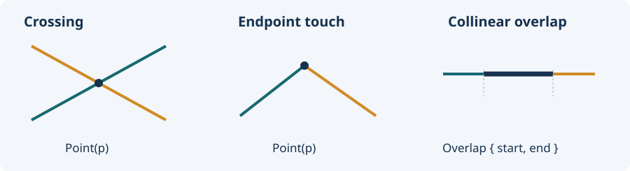

# Math: scalar functions and segment intersection

[Home](../README.md) · [Index](README.md) · [API map](api.md) · [Numeric policies](numerics.md)

[Inverse lerp](#inverse-lerp) · [Remap](#remap) · [Move towards](#move-towards) · [Smooth step](#smooth-step) · [Ping-pong](#ping-pong) · [Smooth damp](#smooth-damp) · [Angles](#angles) · [Segment intersection](#segment-intersection)

Import `use yagmath::Math;`. `Math` has no state: call its associated functions. Scalar functions return `f64` except checked inverse lerp (`Option<f64>`); segment intersection returns `Option<SegmentIntersection2>`. Numeric arguments convert through `ToF64`; wide integers can round. Most pairs of endpoint arguments share one generic type; t, time, step and velocity parameters are explicitly `f64`.

<a id="inverse-lerp"></a>
## inverse_lerp and checked variants

`inverse_lerp(start, end, value)` finds the fraction of the interval reached by value. Conceptually `t=(value-start)/(end-start)`, clamped to `[0,1]`. `inverse_lerp_unclamped` allows extrapolation. Reversed ranges are supported; equal bounds return zero, including integers that become equal after f64 conversion. NaN/infinity may propagate under IEEE arithmetic. The implementation scales extreme differences when necessary.

`checked_inverse_lerp` and `checked_inverse_lerp_unclamped` reject equal/non-finite bounds and non-finite values with `None`. The unclamped checked variant also rejects a non-finite result. Clamped checked calculation can still succeed when extrapolation would overflow because the answer is simply an endpoint.

```rust
use yagmath::Math;
assert_eq!(Math::inverse_lerp(10, 20, 15), 0.5);
assert_eq!(Math::inverse_lerp(10, 20, 25), 1.0);
assert_eq!(Math::inverse_lerp_unclamped(10, 20, 25), 1.5);
assert_eq!(Math::inverse_lerp(20, 10, 15), 0.5);
assert_eq!(Math::inverse_lerp(10, 10, 15), 0.0);
assert_eq!(Math::checked_inverse_lerp(10, 10, 15), None);
assert_eq!(Math::checked_inverse_lerp_unclamped(10, 20, 25), Some(1.5));
```

<a id="remap"></a>
## remap and remap_clamped

`remap(value, in_min, in_max, out_min, out_max)` maps one interval into another. It is **unclamped** by default. `remap_clamped` first clamps the fraction to `[0,1]`. Input arguments share a type I; output endpoints share a separate type O. Reversed intervals work. Equal input bounds return `out_min`. Non-finite inputs/results follow the numeric computation; no `Option` is returned.

```rust
use yagmath::Math;
assert_eq!(Math::remap(50, 0, 100, -1.0, 1.0), 0.0);
assert_eq!(Math::remap(150, 0, 100, 0, 10), 15.0);
assert_eq!(Math::remap_clamped(150, 0, 100, 0, 10), 10.0);
assert_eq!(Math::remap(25, 100, 0, 0, 20), 15.0);
```

<a id="move-towards"></a>
## move_towards

`move_towards(current, target, max_delta)` advances by at most the step without crossing the target. Use `speed * delta_time` for speed per second. A negative/zero step does nothing; +infinity snaps to target. Non-finite endpoints or NaN step return NaN. This implementation deliberately treats a negative step as no movement, not movement away from target.

```rust
use yagmath::Math;
assert_eq!(Math::move_towards(0, 10, 3.0), 3.0);
assert_eq!(Math::move_towards(8, 10, 3.0), 10.0);
assert_eq!(Math::move_towards(10, 0, 3.0), 7.0);
assert_eq!(Math::move_towards(0, 10, -3.0), 0.0);
```

<a id="smooth-step"></a>
## smooth_step

`smooth_step(from, to, t)` clamps t, transforms it by `t²(3-2t)` and interpolates the endpoints. The slope is zero at the beginning and end, useful for fades and transitions. This is the Unity-style **from/to/t** convention, not the shader `smoothstep(edge0, edge1, x)` convention. NaN t propagates; infinite t clamps. Infinite endpoints may produce NaN/infinity.

```rust
use yagmath::Math;
assert_eq!(Math::smooth_step(0, 1, 0.25), 0.15625);
assert_eq!(Math::smooth_step(0, 10, 0.5), 5.0);
assert_eq!(Math::smooth_step(0, 10, 2.0), 10.0);
```

<a id="ping-pong"></a>
## ping_pong

`ping_pong(value, length)` produces a triangle wave from zero to length and back with period `2*length`. Negative values are supported symmetrically. Zero length returns zero for finite value; negative/non-finite lengths and non-finite values return NaN. The returned scalar is a position in the wave, not an accumulated animation state.

```rust
use yagmath::Math;
let values: Vec<_> = (0..7).map(|t| Math::ping_pong(t, 3)).collect();
assert_eq!(values, vec![0.0, 1.0, 2.0, 3.0, 2.0, 1.0, 0.0]);
assert_eq!(Math::ping_pong(-1, 3), 1.0);
```

<a id="smooth-damp"></a>
## smooth_damp

```text
Math::smooth_damp(current, target, &mut velocity, smooth_time, max_speed, delta_time) -> f64
```

Spring-like smoothing that remembers velocity between frames. `smooth_time` is a response time parameter in seconds, not a deadline to reach target. The implementation prevents crossing the target; reaching the target clears velocity. Times are explicit because the crate has no game clock.

| Argument | Meaning |
|---|---|
| current / target | Current value and goal, sharing numeric type T |
| `&mut velocity` | Persisted f64 velocity, in units/second |
| smooth_time | Nonnegative seconds, internally at least `0.0001` |
| max_speed | Nonnegative speed parameter; `f64::INFINITY` removes this limit |
| delta_time | Nonnegative elapsed seconds |

The speed parameter limits the displacement used by the damper. An already-large incoming velocity can still cause a large initial movement; it is not a hard cap on externally supplied velocity. Valid zero delta time preserves current and velocity. Invalid input or non-finite computed output/velocity returns NaN and preserves the caller's velocity. Negative times/speed are invalid.

```rust
use yagmath::Math;
let mut current = 0.0;
let mut velocity = 0.0;
for _ in 0..120 {
    current = Math::smooth_damp(
        current, 10.0, &mut velocity,
        0.3, f64::INFINITY, 1.0 / 60.0,
    );
}
assert!((current - 10.0).abs() < 0.01);
```

Internally, `omega=2/smooth_time` and `x=omega*delta_time`. The decay term `1/(1+x+0.48*x²+0.235*x³)` approximates `exp(-x)` using arithmetic. The constants belong to the damping approximation; they do not encode a unit conversion. The algorithm is approximate and should not be described as bit-identical across engines or completely invariant under arbitrary timestep changes.

<a id="angles"></a>
## Angular helpers

Every angular helper has **`_rad` and `_deg` variants**. Angular steps use the named angle unit; velocities and speed limits use that unit per second. Time remains seconds. Scalar inputs can be f32 or f64 (or another ToF64 type), and results/velocity remain f64. Results are not automatically wrapped into one revolution.

| Function | Behavior |
|---|---|
| `delta_angle_rad(current, target)` | Shortest signed difference in `(-π, π]`; exact half-turn chooses +π |
| `lerp_angle_rad(from, to, t)` | Shortest-arc interpolation; t clamped `[0,1]` |
| `move_towards_angle_rad(current, target, max_delta)` | Advances along the shortest arc without overshooting |
| `smooth_damp_angle_rad(current, target, &mut velocity, smooth_time, max_speed, delta_time)` | Damps toward the nearest equivalent target angle |
| `delta_angle_deg(current, target)` | Shortest signed difference in `(-180, 180]`; exact half-turn chooses +180 |
| `lerp_angle_deg(from, to, t)` | Shortest-arc interpolation in degrees; t clamped `[0,1]` |
| `move_towards_angle_deg(current, target, max_delta)` | Shortest-arc degree movement |
| `smooth_damp_angle_deg(current, target, &mut velocity, smooth_time, max_speed, delta_time)` | Degree damping; velocity/max_speed are degrees/second |

Non-finite angles return/propagate NaN. Step and damping validation follow the ordinary scalar methods. Angular damping velocity must also persist between calls.

Delta reduction is performed in the selected unit without converting degree inputs to radians. Direct subtraction is preferred; overflowing differences fall back to reducing each input first. Signed remainder preserves tiny negative deltas near zero instead of losing them when adding a full turn. Coordinates already rounded in f32 cannot recover their lost precision through this calculation.

```rust
use yagmath::Math;
assert_eq!(Math::delta_angle_deg(350.0_f32, 10.0_f32), 20.0);
assert_eq!(Math::delta_angle_deg(10.0_f64, 350.0), -20.0);
assert_eq!(Math::delta_angle_deg(180.0, 0.0), 180.0);
assert_eq!(Math::lerp_angle_deg(350.0, 10.0, 0.5), 360.0);
assert_eq!(Math::move_towards_angle_deg(350.0, 10.0, 5.0), 355.0);
let mut velocity_deg = 0.0;
let angle_deg = Math::smooth_damp_angle_deg(
    350.0, 10.0, &mut velocity_deg, 0.3, 60.0, 1.0 / 60.0,
);
assert!(angle_deg > 350.0);
```

```rust
use yagmath::Math;
let from = 350.0_f64.to_radians();
let to = 10.0_f64.to_radians();
assert!((Math::delta_angle_rad(from, to).to_degrees() - 20.0).abs() < 1e-10);
assert!((Math::lerp_angle_rad(from, to, 0.5).to_degrees() - 360.0).abs() < 1e-10);
assert!((Math::move_towards_angle_rad(from, to, 5.0_f64.to_radians()).to_degrees() - 355.0).abs() < 1e-10);
let mut velocity = 0.0;
let angle = Math::smooth_damp_angle_rad(from, to, &mut velocity, 0.3, f64::INFINITY, 1.0 / 60.0);
assert!(angle > from);
```

<a id="segment-intersection"></a>
## 2D segment intersection

```text
Math::segment_intersection(a_start, a_end, b_start, b_end) -> Option<SegmentIntersection2>
```

The inputs are four `Vector2` endpoints, not infinite lines or rays. Each segment's endpoints share one scalar type; the other segment may use a different ToF64 type. Endpoints are included. No Segment structure is needed.



| Result | Meaning |
|---|---|
| `None` | No common point, non-finite input, or scaling loses a nonzero coordinate |
| `Some(SegmentIntersection2::Point(point))` | Crossing or touching at one point |
| `Some(SegmentIntersection2::Overlap { start, end })` | Collinear segments share a nonzero-length segment |

Overlap endpoints follow the **first input segment's direction**. Reversing that segment reverses start/end in the result. Zero-length segments are treated as points: a point on the other closed segment intersects it. Two equal points intersect each other. The result enum is available from the crate root and `yagmath::math`; it derives Debug, Clone, Copy and PartialEq.

```rust
use yagmath::{Math, SegmentIntersection2, vector::Vector2};
let hit = Math::segment_intersection(
    Vector2::new(0, 0), Vector2::new(4, 4),
    Vector2::new(0, 4), Vector2::new(4, 0),
);
assert_eq!(hit, Some(SegmentIntersection2::Point(Vector2::new(2.0, 2.0))));

let overlap = Math::segment_intersection(
    Vector2::new(0, 0), Vector2::new(6, 0),
    Vector2::new(2, 0), Vector2::new(8, 0),
);
assert_eq!(overlap, Some(SegmentIntersection2::Overlap {
    start: Vector2::new(2.0, 0.0),
    end: Vector2::new(6.0, 0.0),
}));

// A simple yes/no query needs no additional method.
assert!(overlap.is_some());
```

For nonparallel segments, write `a+t*r = c+u*s`. The method computes `t=cross(c-a,s)/cross(r,s)` and `u=cross(c-a,r)/cross(r,s)` and accepts only parameters in `[0,1]`. Parallel collinear segments are intersected as intervals along a nonconstant axis. Each coordinate axis is first scaled by a power of two to reduce overflow without introducing a general division rounding error for ordinary values.

This uses f64 arithmetic and **no implicit epsilon**. Nearly parallel/collinear segments, determinant underflow, and wide-integer rounding can affect classification. It is not an exact geometric predicate; None does not distinguish invalid input from no intersection. Use a geometry library with exact predicates if that distinction/robustness is required. A point-or-segment result is a common geometry convention; see the [CGAL intersection reference](https://doc.cgal.org/latest/Kernel_23/group__intersection__linear__grp.html) for an independent exact-kernel API using that shape.
