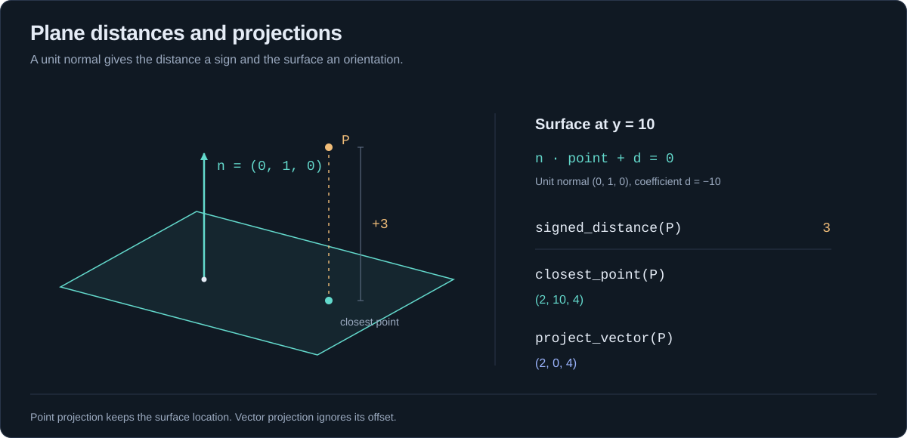

# Plane: an oriented 3D surface

[Home](../README.md) · [Index](README.md) · [Vectors](vectors.md) · [Numeric policies](numerics.md)

[Equation](#equation) · [Construction](#construction) · [Queries and projection](#queries) · [Orientation](#orientation)

Import `yagmath::Plane` or `yagmath::plane::Plane`. This is a concrete f64 type, not `Plane<T>`.

The optional [Serde feature](serde.md) supports saving and loading coefficients,
with unit-normal and finite-distance validation when decoding.



<a id="equation"></a>
## Storage and equation

```text
normal.dot(point) + distance = 0
```

The normal is a unit `Vector3<f64>` and distance is a finite `f64` coefficient. Fields are private to preserve the invariant. For a horizontal plane at y=10, normal=(0,1,0) and distance=-10. The coefficient equals `signed_distance(origin)`; it is not the unsigned height of the plane. Floating-point calculations are approximate even though the geometric invariant is unit length.

<a id="construction"></a>
## Constructors

* `from_normal_point(normal, point) -> Option<Plane>` normalizes the supplied normal. Normal and point may have different scalar types implementing ToF64. Zero/non-finite normals, invalid points and unrepresentable offsets fail.
* `from_points(a, b, c) -> Option<Plane>` follows `(b-a).cross(c-a)`, using the right-hand rule. Points share one scalar type. Coincident/collinear/non-finite points fail; floating-point rounding/underflow can also make a configuration degenerate. Swapping b and c reverses orientation.

Constructors use scaling for huge/subnormal inputs. They cannot recover precision already lost in the coordinates or when converting wide integers to f64. No Default exists because a zero normal would be invalid.

```rust
fn main() -> Result<(), Box<dyn std::error::Error>> {
    use yagmath::{Plane, vector::Vector3};
    let plane = Plane::from_normal_point(Vector3::new(0, 5, 0), Vector3::new(0, 10, 0)).ok_or("cannot construct a plane from these inputs")?;

    assert_eq!(plane.normal(), Vector3::new(0.0, 1.0, 0.0));
    assert_eq!(plane.distance(), -10.0);

    let xy = Plane::from_points(
        Vector3::new(0, 0, 0), Vector3::new(1, 0, 0), Vector3::new(0, 1, 0),
    ).ok_or("cannot construct a plane from these inputs")?;

    assert_eq!(xy.normal(), Vector3::new(0.0, 0.0, 1.0));
    assert!(Plane::from_normal_point(Vector3::new(0, 0, 0), Vector3::new(0, 0, 0)).is_none());

    Ok(())
}
```

<a id="queries"></a>
## Every query method

| Method | Result | Meaning |
|---|---|---|
| `normal()` | `Vector3<f64>` | Unit normal, returned by value |
| `distance()` | `f64` | Equation's constant coefficient |
| `signed_distance(point)` | `f64` | `dot(normal,point)+distance`; positive on normal side |
| `closest_point(point)` | `Vector3<f64>` | `point - normal*signed_distance(point)` |
| `project_vector(vector)` | `Vector3<f64>` | `vector - normal*dot(normal,vector)`; ignores plane offset |
| `flipped()` | `Plane` | Same surface, reversed normal and coefficient |

Query arguments may use any ToF64 numeric type. Signed distance can yield NaN/infinity. Projection returns all-NaN components for non-finite inputs or result overflow. Scaling can keep a projection finite even when the signed distance overflows.

**Point projection and vector projection differ:** a point has a location; a vector describes a displacement. Projecting a velocity onto the ground removes its vertical component, without adding the ground's height.

```rust
fn main() -> Result<(), Box<dyn std::error::Error>> {
    use yagmath::{Plane, vector::Vector3};
    let ground = Plane::from_normal_point(Vector3::new(0, 1, 0), Vector3::new(0, 10, 0)).ok_or("cannot construct a plane from these inputs")?;

    assert_eq!(ground.signed_distance(Vector3::new(0, 13, 0)), 3.0);
    assert_eq!(ground.signed_distance(Vector3::new(0, 8, 0)), -2.0);
    assert_eq!(ground.closest_point(Vector3::new(2, 13, 4)), Vector3::new(2.0, 10.0, 4.0));
    assert_eq!(ground.project_vector(Vector3::new(2, 13, 4)), Vector3::new(2.0, 0.0, 4.0));

    Ok(())
}
```

<a id="orientation"></a>
## Orientation, equality and limits

`Plane` derives `Debug`, `Clone`, `Copy`, `PartialEq`. Equality is exact comparison of stored coefficients, including orientation, not approximate equality of geometric surfaces. A flipped plane usually compares unequal even though it contains the same points. Flipping twice restores the original coefficients.

```rust
fn main() -> Result<(), Box<dyn std::error::Error>> {
    use yagmath::{Plane, vector::Vector3};
    let plane = Plane::from_normal_point(Vector3::new(0, 1, 0), Vector3::new(0, 10, 0)).ok_or("cannot construct a plane from these inputs")?;
    let flipped = plane.flipped();

    assert_eq!(flipped.signed_distance(Vector3::new(0, 13, 0)), -3.0);
    assert_eq!(flipped.closest_point(Vector3::new(2, 13, 4)), plane.closest_point(Vector3::new(2, 13, 4)));
    assert_eq!(flipped.flipped(), plane);
    assert_ne!(flipped, plane);

    Ok(())
}
```

There is currently no ray/segment intersection, three-plane intersection, frustum or plane transformation API.
