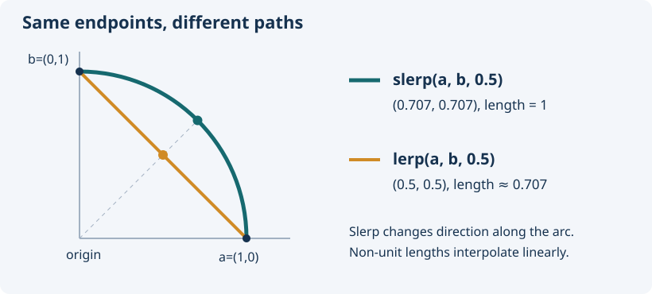

# Vectors

[Home](../README.md) · [Index](README.md) · [API map](api.md) · [Numeric policies](numerics.md)

[Creation](#creation) · [Operators](#operators) · [Directions](#directions) · [Length and distance](#length-distance) · [Normalization](#normalization) · [Dot, cross and angles](#products-angles) · [Interpolation](#interpolation) · [Movement](#movement) · [Rotation](#rotation) · [Reflection](#reflection) · [Limits](#limits) · [Rounding](#rounding) · [Conversion](#conversion)

`Vector2<T>` has `x, y`, `Vector3<T>` adds `z`, `Vector4<T>` adds `w`. Fields are public. `V<T>` below means a vector of the same dimension, not an actual exported alias. Most geometry requires `T: ToF64` and returns `f64` components. Cross products and rotations have dimension-specific signatures.



<a id="creation"></a>
## Creation and basic traits

| API | Result / requirement |
|---|---|
| `Vector2::new(x, y)` | `Vector2<T>`; no scalar bounds |
| `Vector3::new(x, y, z)` | `Vector3<T>`; no scalar bounds |
| `Vector4::new(x, y, z, w)` | `Vector4<T>`; no scalar bounds |
| `V::<T>::default()` | Each field is `T::default()` |
| `Clone`, `Copy`, `PartialEq`, `Eq`, `Hash`, `Debug` | Available when T supports the relevant trait |
| `Display` | `(x, y, ...)`, when T implements Display |

There is no implicit float tolerance in equality. Float vectors do not implement `Eq` or `Hash`. The types can store nonnumeric components; numeric methods become available through their own bounds.

```rust
use yagmath::vector::{Vector2, Vector3, Vector4};
let mut position = Vector2::new(3_i32, 4);
position.x = 6;
assert_eq!(position, Vector2::new(6, 4));
assert_eq!(Vector3::<i32>::default(), Vector3::new(0, 0, 0));
assert_eq!(Vector4::new(1, 2, 3, 4).to_string(), "(1, 2, 3, 4)");
let labels = Vector2::new("left", "right");
assert_eq!(labels.x, "left");
```

<a id="operators"></a>
## Operators

| Expression | Result | Meaning |
|---|---|---|
| `a + b`, `a - b` | `V<T>` | Componentwise, via SafeAdd/SafeSub |
| `a * b` | `V<T>` | Componentwise multiplication, not dot/cross |
| `a * scalar` | `V<T>` | Right-hand scalar multiplication; scalar type is T |
| `a / b`, `a / scalar` | `Option<V<T>>` | All components must divide successfully |
| `a += b`, `a -= b`, `a *= b`, `a *= scalar` | Mutates a | Same scalar policies |

Integer add/sub/mul saturate. Float add/sub/mul use ordinary IEEE operations. Integer division truncates toward zero; division by zero or signed `MIN / -1` fails. Float division rejects zero (including -0), non-finite inputs and non-finite outputs. There are no scalar `+`/`-`, left-hand `scalar * vector`, unary vector `-`, or `/=` implementations.

```rust
use yagmath::vector::Vector2;
assert_eq!(Vector2::new(120_i8, -120) + Vector2::new(20, -20), Vector2::new(127, -128));
assert_eq!(Vector2::new(2, 3) * Vector2::new(4, 5), Vector2::new(8, 15));
assert_eq!(Vector2::new(2, 3) * 4, Vector2::new(8, 12));
assert_eq!(Vector2::new(9, -9) / 2, Some(Vector2::new(4, -4)));
assert_eq!(Vector2::new(9, 3) / Vector2::new(3, 0), None);
let mut v = Vector2::new(1, 2);
v += Vector2::new(3, 4);
v -= Vector2::new(1, 1);
v *= Vector2::new(2, 3);
v *= 2;
assert_eq!(v, Vector2::new(12, 30));
```

<a id="directions"></a>
## Direction constructors

| Constructor | Axis | Dimensions |
|---|---|---|
| `zero()` | All zero | 2/3/4 |
| `right()`, `left()` | +X, -X | 2/3/4 |
| `up()`, `down()` | +Y, -Y | 2/3/4 |
| `forward()`, `backward()` | +Z, -Z | 3/4 |

All unused fields, including W, are zero. These need `DirectionScalar`; negative directions additionally need `Neg<Output=T>`, so unsigned types only have positive directions and zero.

```rust
use yagmath::vector::{Vector2, Vector3, Vector4};
assert_eq!(Vector2::<i32>::left(), Vector2::new(-1, 0));
assert_eq!(Vector2::<u32>::up(), Vector2::new(0, 1));
assert_eq!(Vector3::<f64>::backward(), Vector3::new(0.0, 0.0, -1.0));
assert_eq!(Vector4::<i32>::forward(), Vector4::new(0, 0, 1, 0));
assert_eq!(Vector4::<i32>::zero(), Vector4::new(0, 0, 0, 0));
```

<a id="length-distance"></a>
## Length and distance

| Method | Returns | Formula |
|---|---|---|
| `length()` | `f64` | `sqrt(sum(component²))`, evaluated with hypot |
| `length_squared()` | `f64` | `sum(component²)` |
| `distance(other)` | `f64` | Length of the difference |
| `distance_squared(other)` | `f64` | Squared length of the difference |

Distance arguments use the same scalar type as self. Conversion happens before subtraction, preventing integer subtraction overflow. Squared variants can overflow/underflow sooner than hypot-based variants. Wide integers can round during conversion.

```rust
use yagmath::vector::Vector2;
let v = Vector2::new(3, 4);
assert_eq!(v.length(), 5.0);
assert_eq!(v.length_squared(), 25.0);
assert_eq!(v.distance(Vector2::new(0, 0)), 5.0);
assert_eq!(v.distance_squared(Vector2::new(0, 0)), 25.0);
assert!(v.distance_squared(Vector2::zero()) <= 6.0 * 6.0);
```

<a id="normalization"></a>
## Normalization

`normalized(&self) -> Option<V<f64>>` returns a new direction. `normalize(&mut self) -> Option<()>` changes a float vector (`f32` or `f64`) in place. Neither accepts a zero/non-finite length; failures leave the original unchanged. Finite components whose combined magnitude overflows also fail. Subnormal handling reduces avoidable precision loss, but results remain floating point.

```rust
use yagmath::vector::Vector2;
assert_eq!(Vector2::new(3, 4).normalized(), Some(Vector2::new(0.6, 0.8)));
let mut v = Vector2::new(3.0_f32, 4.0);
assert_eq!(v.normalize(), Some(()));
assert_eq!(v, Vector2::new(0.6, 0.8));
assert_eq!(Vector2::<i32>::zero().normalized(), None);
```

<a id="products-angles"></a>
## Dot, cross and angle

* `dot(other) -> f64`: sum of pairwise products. Inputs have the same scalar type. For unit inputs it gives the cosine; arbitrary magnitudes also contribute.
* `Vector2::cross(other) -> f64`: `ax*by - ay*bx`, the signed 2D determinant.
* `Vector3::cross(other) -> Vector3<f64>`: right-handed cross product. There is no binary Vector4 cross method.
* `angle_between_rad(other) -> f64`: unsigned angle `[0, π]`; mixed scalar types work. Normalization is automatic. Zero/non-finite directions return NaN. This is not a signed angle or a heading.
* `angle_between_deg(other) -> f64`: the same angle in `[0, 180]` degrees, available for Vector2/3/4.
* `Vector2::signed_angle_rad(other) -> f64`: signed shortest angle `[-π, π]`; positive is counterclockwise, negative is clockwise in X-right/Y-up coordinates.
* `Vector3::signed_angle_rad(other, axis) -> f64`: full angle_between_rad magnitude, with sign determined by `axis.dot(self.cross(other))`. Positive follows the right-hand rule around axis. Axis controls the sign only; inputs are **not projected** onto its perpendicular plane. Neither inputs nor axis need normalization, and all three may use different scalar types.

Signed angles return NaN for zero/non-finite input directions; 3D also rejects a zero/non-finite axis. An exact half-turn chooses +π; a zero triple-product sign also chooses the positive angle. Near-degenerate signs are subject to float rounding/underflow. A single axis does not define signed rotation in 4D, so Vector4 has no signed_angle_rad method.

`signed_angle_deg` has the same 2D/3D arguments and validation as `signed_angle_rad`, with results in `[-180, 180]` degrees. The exact half-turn tie is +180. All angular vector results are f64, even when components are f32 or integers.

```rust
use yagmath::vector::{Vector2, Vector3};
let x = Vector3::<i32>::right();
let y = Vector3::<i32>::up();
assert_eq!(x.dot(y), 0.0);
assert_eq!(x.cross(y), Vector3::new(0.0, 0.0, 1.0));
assert_eq!(Vector2::new(1, 0).cross(Vector2::new(0, 1)), 1.0);
assert_eq!(x.angle_between_rad(y).to_degrees(), 90.0);
assert!(x.angle_between_rad(Vector3::<i32>::zero()).is_nan());
```

```rust
use yagmath::vector::{Vector2, Vector3};
let right = Vector2::<i32>::right();
let up = Vector2::<i32>::up();
assert_eq!(right.signed_angle_rad(up).to_degrees(), 90.0);
assert_eq!(up.signed_angle_rad(right).to_degrees(), -90.0);

let right = Vector3::<i32>::right();
let up = Vector3::<i32>::up();
assert_eq!(right.signed_angle_rad(up, Vector3::<i32>::forward()).to_degrees(), 90.0);
assert_eq!(right.signed_angle_rad(up, Vector3::<i32>::backward()).to_degrees(), -90.0);
```

```rust
use yagmath::vector::{Vector2, Vector3};
assert_eq!(Vector2::<i32>::right().angle_between_deg(Vector2::<i32>::up()), 90.0);
assert_eq!(Vector2::<i32>::up().signed_angle_deg(Vector2::<i32>::right()), -90.0);
assert_eq!(Vector3::<i32>::right().signed_angle_deg(
    Vector3::<i32>::up(), Vector3::<i32>::backward(),
), -90.0);
```

<a id="interpolation"></a>
## Lerp and slerp

| Method | t | Result |
|---|---|---|
| `lerp(other, t)` | Clamped `[0,1]` | `V<f64>` on a straight segment |
| `lerp_unclamped(other, t)` | Unrestricted | Linear extrapolation |
| `slerp(other, t)` | Clamped `[0,1]` | Direction follows a shortest arc; length changes linearly |
| `slerp_unclamped(other, t)` | Unrestricted finite t | Extrapolates angle and signed length |

Lerp needs the same scalar type and evaluates `a + (b-a)*t` per component; extreme inputs can overflow even at t=0 or 1. Slerp accepts mixed scalar types and keeps unit inputs unit length within precision. It returns all-NaN components for zero/non-finite vectors, invalid t or result overflow. In clamped slerp, ±infinite t clamps to an endpoint. Valid slerp endpoints are exact; zero vectors are rejected even at endpoints.

Opposite directions do not define a unique arc. The implementation projects the least-aligned positive coordinate axis onto the plane perpendicular to the starting direction; ties use field order. This deterministic choice can change abruptly near opposite directions. In 4D, interpolation still uses a two-dimensional arc through the input directions; it does not imply quaternion interpolation.

```rust
use yagmath::vector::Vector2;
let a = Vector2::new(1, 0);
let b = Vector2::new(0, 1);
assert_eq!(a.lerp(b, 0.5), Vector2::new(0.5, 0.5));
assert_eq!(a.lerp_unclamped(b, 2.0), Vector2::new(-1.0, 2.0));
let halfway = a.slerp(b, 0.5);
assert!((halfway.length() - 1.0).abs() < 1e-12);
assert!((a.angle_between_rad(halfway).to_degrees() - 45.0).abs() < 1e-10);
let extrapolated = a.slerp_unclamped(b, 2.0);
assert!((extrapolated.x + 1.0).abs() < 1e-12);
```

<a id="movement"></a>
## Move towards

`move_towards(target, max_delta) -> V<f64>` returns a new position along the line to target, limiting **total Euclidean distance**, not individual coordinates. Mixed scalar types work. Negative/zero steps leave the converted starting point unchanged; +infinity snaps to target. Invalid components or NaN steps return an all-NaN vector. Use `speed * delta_time` as the step for units/second movement.

```rust
use yagmath::vector::Vector2;
let position = Vector2::new(0, 0);
assert_eq!(position.move_towards(Vector2::new(3, 4), 2.5), Vector2::new(1.5, 2.0));
assert_eq!(position.move_towards(Vector2::new(3, 4), 20.0), Vector2::new(3.0, 4.0));
```

<a id="rotation"></a>
## Rotation

| Dimension | New-copy method | In-place method |
|---|---|---|
| 2 | `rotated_rad(angle)` | `rotate_rad(angle)` |
| 3 | `rotated_rad(angle, axis)` | `rotate_rad(angle, axis)` |
| 4 | `rotated_rad(angle, (i,j))` | `rotate_rad(angle, (i,j))` |

The methods above take radians. `rotated_deg` and `rotate_deg` have the same dimension-specific arguments but take degrees; full turns are reduced before conversion. New-copy methods accept `ToF64` components and return `Option<V<f64>>`. In-place methods exist on `f32/f64`, returning `Option<()>`; failure leaves self unchanged. Non-finite inputs/results fail. 2D positive rotation is counterclockwise (+X toward +Y). 3D uses a normalized axis through the origin and the right-hand rule; zero axes fail. 4D indices `0,1,2,3` mean `x,y,z,w`; positive rotation takes axis i toward j, preserving other coordinates. Equal or out-of-range indices fail.

```rust
use yagmath::vector::{Vector2, Vector3, Vector4};
use std::f64::consts::FRAC_PI_2;
let v = Vector2::new(1, 0).rotated_rad(FRAC_PI_2).unwrap();
assert!((v.y - 1.0).abs() < 1e-12);
let v = Vector3::new(1, 0, 0).rotated_rad(FRAC_PI_2, Vector3::new(0, 0, 2)).unwrap();
assert!((v.y - 1.0).abs() < 1e-12);
let mut v = Vector4::new(1.0_f64, 0.0, 7.0, 8.0);
v.rotate_rad(FRAC_PI_2, (0, 1)).unwrap();
assert_eq!((v.z, v.w), (7.0, 8.0));
assert!((v.y - 1.0).abs() < 1e-12);
let mut v = Vector2::new(1.0_f32, 0.0);
v.rotate_rad(FRAC_PI_2).unwrap();
let mut v = Vector3::new(1.0_f64, 0.0, 0.0);
v.rotate_rad(FRAC_PI_2, Vector3::<i32>::forward()).unwrap();
```

```rust
use yagmath::vector::{Vector2, Vector3, Vector4};
let v = Vector2::new(1, 0).rotated_deg(90.0).unwrap();
assert!((v.y - 1.0).abs() < 1e-12);
let v = Vector3::new(1, 0, 0).rotated_deg(90.0, Vector3::<i32>::forward()).unwrap();
assert!((v.y - 1.0).abs() < 1e-12);
let mut v = Vector4::new(1.0_f32, 0.0, 7.0, 8.0);
v.rotate_deg(90.0, (0, 1)).unwrap();
assert!((v.y - 1.0).abs() < 1e-6);
```

<a id="reflection"></a>
## Reflection

`reflected(normal) -> Option<V<f64>>` returns `v - 2*dot(v,n)*n` with an automatically normalized normal. Works in 2D, 3D and 4D and accepts mixed scalar types. `reflect(normal) -> Option<()>` mutates only float vectors. Zero/non-finite normals, invalid vectors and result overflow fail; in-place failure preserves self. A zero input vector with a valid normal is valid. Reflects a direction about a surface through the origin, not a point about an offset plane.

```rust
use yagmath::vector::Vector2;
assert_eq!(Vector2::new(1, -1).reflected(Vector2::new(0, 5)), Some(Vector2::new(1.0, 1.0)));
let mut velocity = Vector2::new(1.0_f64, -1.0);
velocity.reflect(Vector2::new(0, 1)).unwrap();
assert_eq!(velocity, Vector2::new(1.0, 1.0));
```

<a id="limits"></a>
## Component limits and magnitude limits

`min(other)` / `max(other)` select per-component values and preserve T (`PartialOrd`). For float inputs, a single NaN loses to the other value; two NaNs remain NaN. These methods do not select the shorter/longer vector.

`clamp(min, max) -> Option<V<T>>` limits each coordinate inclusively, rejecting reversed/incomparable bounds or NaN input. `clamp_length_max(max) -> Option<V<f64>>` limits magnitude instead, preserving direction. It accepts zero, rejects negative/non-finite maxima and invalid components, and leaves short vectors unchanged after conversion.

```rust
use yagmath::vector::Vector2;
let a = Vector2::new(3, 8);
let b = Vector2::new(5, 2);
assert_eq!(a.min(b), Vector2::new(3, 2));
assert_eq!(a.max(b), Vector2::new(5, 8));
assert_eq!(a.clamp(Vector2::new(0, 0), Vector2::new(4, 4)), Some(Vector2::new(3, 4)));
assert_eq!(Vector2::new(3, 4).clamp_length_max(2.5), Some(Vector2::new(1.5, 2.0)));
```

<a id="rounding"></a>
## Rounding

`floor()`, `ceil()`, `round()` return a new vector **with the same component type**. For floats they use standard scalar rounding, preserving NaN/infinity; round ties go away from zero. Integer implementations are unchanged copies. Rounding does not convert floats into integer types.

```rust
use yagmath::vector::Vector2;
let v = Vector2::new(1.5_f64, -1.5);
assert_eq!(v.floor(), Vector2::new(1.0, -2.0));
assert_eq!(v.ceil(), Vector2::new(2.0, -1.0));
assert_eq!(v.round(), Vector2::new(2.0, -2.0));
assert_eq!(Vector2::new(1_i32, -2).round(), Vector2::new(1, -2));
```

<a id="conversion"></a>
## Conversion

`convert::<U>(mode)` changes the component type, not dimension. `convert_with_rounding::<U>(mode, rounding)` also controls float-to-integer rounding. Both return `Result<V<U>, ConversionError>` and require `U: ConvertFrom<T>`. [Conversion reference and examples](conversion.md) cover every policy and error.
